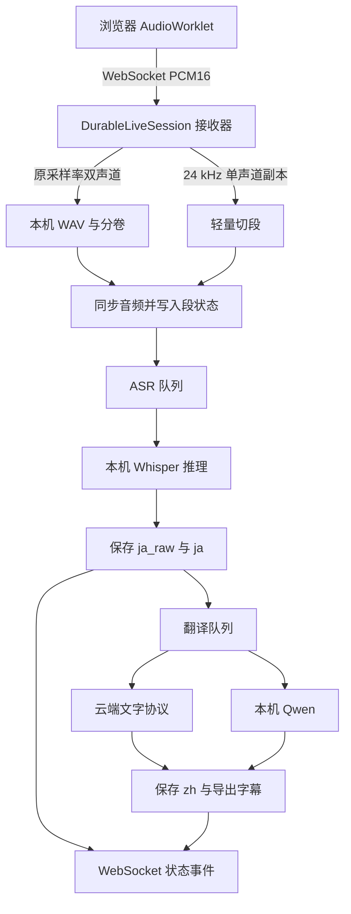

# 后端架构与数据约定

本文根据当前 `yakiniku/` 源码整理，面向二次开发和代码审查。用户操作见 [README](../README.md)，环境和技术栈总览见 [开发指南](development.md)。

## 服务边界

后端是单进程的本机 Python 应用。`run.py` 用 Uvicorn 启动 `yakiniku.server:app`，默认监听 `127.0.0.1:8765`；`--port` 可修改端口。FastAPI 同时提供 REST API、音频 WebSocket 和 `static/` 静态资源。项目没有数据库、Redis、Celery、独立消息代理或前后端构建服务。

该实现依赖进程内的录制占用标志、模型运行时和任务集合，开发时应保持**单个服务进程、单个 Uvicorn worker**。不能直接通过增加 worker 扩容，否则不同进程将无法共享录制预留、模型状态和文件写入互斥。

当前普通直播使用 `DurableLiveSession`：本机 ASR 后只进行一次中文翻译。`server.py` 中的 `LiveSession` 及 `provider.py` 的云端实时/分段识别适配器仍用于兼容旧路径和注入测试；存在这些类不表示新直播默认上传音频。

## 技术与模块

| 技术或模块 | 实际用途 |
| --- | --- |
| FastAPI、Starlette、Pydantic | 路由、WebSocket、静态资源、生命周期与输入校验；Host 防护由 Starlette 中间件提供 |
| Uvicorn | 本机 ASGI 服务；入口见 `run.py` |
| HTTPX | 云端文字/语音请求、模型列表与模型文件下载；项目直接构造 HTTP 请求，无 OpenAI/Anthropic SDK 依赖 |
| `websockets` | 旧云端 Realtime 识别适配器使用的客户端连接 |
| `asyncio` | WebSocket 接收、受限任务队列、网络并发、任务取消和下载子进程管理 |
| `concurrent.futures.ThreadPoolExecutor` | 串行执行本机模型加载与推理，防止阻塞 ASGI 事件循环 |
| MLX、`mlx-whisper`、Apple Metal | Apple Silicon 上的本机 Whisper 推理 |
| `mlx-lm` | 本机 Qwen 4-bit 日译中；与 ASR 共用单线程推理执行器 |
| `faster-whisper` / CTranslate2 | 显式 Tiny CPU INT8 兼容模式；同时保留旧本机导入适配器 |
| NumPy、PyAV / FFmpeg 库 | PCM 转换、文件解码、重采样和分块；由相关模型依赖间接安装，源码直接使用 |
| SciPy（可选） | `resample_poly` 重采样；不可用时 ASR PCM 转换使用 NumPy 插值 |
| Python `wave`、`struct`、`json`、`hashlib`、文件系统 | PCM16 WAV、轻量切段、JSON 状态、字幕导出与模型完整性校验 |
| FFmpeg 命令行 | Space 下载中的 HLS 音频解码、MP3 转码与完整解码验收；与 PyAV 导入流程分开 |

| 源文件 | 职责 |
| --- | --- |
| `server.py` | 应用装配、REST/WS、全局任务互斥、录制预留、注入测试入口 |
| `audio.py` | WAV 写入和三小时分卷、基于能量及静音的轻量语音切段 |
| `live_pipeline.py` | 持久化直播段、ASR/翻译队列、实时预算、停止补全和失败重试 |
| `model_runtime.py` | 本机 ASR 引擎、加载预热、单线程调度、模型来源校验 |
| `model_downloads.py` | 固定清单的 ASR 权重下载、取消、SHA256 校验和完成后安装 |
| `local_translation.py` | 本机文字模型加载、提示词构造、输入/输出限制、串行生成和结果校验 |
| `local_translation_models.py` | Qwen 模型目录、ModelScope 文件清单、内存估计和下载管理 |
| `local_transcriber.py` | 原 Tiny 本机识别适配器及旧项目所需的模型加载 |
| `provider.py` | 文字协议适配与错误解析，以及旧云端 Realtime/分块识别客户端 |
| `file_transcriber.py` | 文件 ASR 请求；解析 `verbose_json`、`json`、SRT 为统一字幕段 |
| `text_pipeline.py` | 文件处理的日语校对 → 中文翻译顺序及每步持久化检查点 |
| `import_audio.py` | 流式文件导入后的解码、分块识别、校对翻译和断点恢复 |
| `subtitle_split.py` | 按标点、长度和时间限制拆分导入字幕 |
| `refinement.py` | 原直播录音的独立精修项目、服务快照和原音频校验 |
| `storage.py` | 设置、场次 JSON、原子写入、导出、文件名白名单与重启恢复 |
| `config.py`、`service_config.py`、`live_config.py` | 地址规则、服务连接/业务路由、模块保存冲突和直播独立设置 |
| `space_downloads.py` | Space 捕获令牌、HLS 验证、下载任务与子进程生命周期 |
| `diagnostics.py` | 不生成内容的配置探测与协议对应的模型列表读取，不上传音频或字幕 |

## 直播数据流



1. 前端先请求 `POST /api/sessions`。服务检查互斥状态、本机 ASR 就绪状态和所选翻译方式，建立场次与 60 秒有效的单次连接预留令牌。
2. 前端连接 `/ws/{identifier}?token=...`。二进制包的第一个字节区分流：`0` 是原始 PCM16 录音，`1` 是 24 kHz 单声道识别副本；包体上限为 1 MiB。原录音保存为双声道 WAV，采样率来自浏览器。
3. 识别副本只用于轻量切段。默认静音阈值约 600 ms、最长段 5 秒，另有 250 ms 预留前文。Whisper 按段识别，不能视为逐字流式 ASR。
4. 提交段任务前，服务先同步对应 WAV，并保存音频区间及段状态。队列中主要保存已落盘音频的引用，ASR 从 WAV 区间读取原音频，转换为 16 kHz float32 后执行推理。
5. 识别成功即保存并推送日语；直播不调用独立校对，`ja_raw` 与 `ja` 保留同一识别文本。翻译引用最近至多四段日语上下文，各段根据 ID 独立关联结果。
6. 结束时前端 flush 尾包，服务回应已收到的精确帧数；`stop` 控制消息触发停止。服务先关闭并导出音频，发出 `audio_saved`，再排空队列并补全延后任务，最终发出 `saved`。

文本控制消息包括 `flush`、`caption_displayed` 和 `stop`。常用下行事件包括 `ready`、`transcript`、`translation`、`segment_status`、`progress`、`warning`、`connection`、`audio_ack`、`audio_saved`、`saved`。实时段带有 `session_id`、`segment_id`、`sequence`，供前端隔离场次、处理乱序及回报显示耗时。

字幕时钟基于累计音频采样数，不基于网络响应到达时间。三小时 WAV 分卷保持整场时间轴，分卷起止位置放在 `audio_parts` 中。

## 并发、超时与恢复

以下是当前代码常量，用于理解性能约束，并非吞吐或延迟保证。

| 环节 | 当前限制 |
| --- | --- |
| 直播 ASR 队列 | 最多 3 个排队段，1 个异步 ASR worker |
| 直播翻译队列 | 最多 6 个排队段 |
| 云端直播翻译 | 最多 3 个异步 worker |
| 本机直播翻译 | 1 个异步 worker，与 ASR 共用单线程执行器 |
| 实时队列预算 | 排队超过 3 秒的段标为 `deferred`，保留音频待补全 |
| 直播翻译请求 | 4 秒预算；默认文字客户端每次实时调用仅尝试一次 |
| 停止后补全翻译 | 35 秒预算；成功译文不重复请求 |
| ASR 运行时提交 | 最多 4 项已提交或正在执行的本机任务 |
| 本机翻译运行时提交 | 最多 2 项，防止调用者超时后原生推理继续积压 |
| 文件导入校对翻译 | 3 个异步 worker，每段整条文字链预算 120 秒 |
| Space 转码下载 | `asyncio.Semaphore(1)`，一次执行一个下载器 |

本机 ASR 和文字模型可以同时驻留内存，但正常应用中共用一个执行器，因此同一时刻只执行一项本机推理。`asyncio` 超时不能强制中断已开始的原生推理；实现通过 `shield`、有限提交及排队任务取消控制生命周期。

超出队列容量、超过实时预算或翻译超时的段先持久标为延后；实际失败的请求保留为失败，停止流程不会无限自动重试鉴权错误。停止后按时间顺序补全延后段，用户显式重试还可补失败段。ASR 运行时故障时继续保存录音，并提示进入仅录音状态。

重启时 `SessionStore.recover()` 将中断的场次及运行中段改为可恢复状态，重新检查 WAV 头和分卷时长；恢复不等于自动重启所有旧任务。用户从项目入口继续处理。服务器已收到但识别副本尚未覆盖的原音频尾区间，可从 WAV 重新切段；尚未传到服务器的采样无法恢复。

直播快照固定 ASR 后端/模型、权重来源、翻译路由或本机翻译模型、术语表与切段参数，恢复时检查目的地指纹和权重来源。更换域名、协议或模型权重后不能无提示继续原场次。

## 文件导入与精准校验

新文件导入流程为：

```text
原文件流式写入 → 校验可解码音轨 → PyAV 解码为 48 kHz 双声道 WAV
→ 120 秒块转换为 16 kHz 单声道 WAV → 云端文件 ASR
→ 字幕分句 → 日语校对 → 中文翻译 → 导出与预览
```

`POST /api/imports` 的请求体是原文件字节，文件名在 URL 编码的 `X-Filename` 中传递，可选标题使用 `X-Title`；这里不是 multipart 表单上传。大小上限 8 GiB，服务逐块写入并在完整性校验后原子替换为 `source.<扩展名>`。原文件保留，预览 WAV 是独立生成物。

文件 ASR 支持 OpenAI 兼容 `/audio/transcriptions` 与 MiniMax 原生 `/speech_to_text`，不能仅凭文字协议兼容就认定支持语音。`verbose_json`、`srt` 使用可用的服务时间戳；仅返回文字的 `json` 会按文本比例估算时间并记录警告。自动分句默认开启，目标 24 字、最长 6 秒；新项目保存其分句快照，重试不改已有边界。

`TextPipeline` 先保存 `ja_raw`，校对完成后立刻落盘 `ja` 和 `correction_status=done`，随后翻译。因此翻译失败后可以保留成功校对，只补译文。识别进度通过 `import_transcribed_ms` 记录；已完成的识别和成功译文不重复提交。旧本机导入项目保留 30 秒本机识别路径，不因修改全局配置而自动上传。

精准校验为原直播建立独立导入项目，保留 `refinement_source_id`，不会覆盖原直播音频和字幕。当前代码要求 MiniMax 原生文件 ASR 与名称匹配 GPT 的校对/翻译模型，并在开始前要求 `consent=true`。快照固定服务连接、模型和术语；恢复还会检查原始分卷的格式、大小、帧数和修改时间。

普通导入创建时保存语音模式、识别进度和分句设置，**没有精修项目那样完整固定服务连接指纹的快照**；重试配置解析应以 `AudioImportManager.validate_settings()` 为准。不要把精修和直播的目的地固定保证直接扩展到所有旧导入项目。

## 配置与持久化

默认目录如下：

```text
data/
├── settings.json                    # 私有设置和服务凭据
├── recordings/<32位十六进制ID>/
│   ├── session.json                 # 场次、片段、快照、进度与状态
│   ├── audio.wav                   # PCM16；直播通常 48 kHz 双声道
│   ├── audio-002.wav               # 后续分卷，默认每三小时一卷
│   ├── source.<扩展名>             # 仅文件导入，原始文件
│   ├── ja.srt
│   ├── zh-CN.srt
│   ├── bilingual.srt
│   ├── bilingual.vtt
│   └── transcript.txt
├── models/                          # ASR 权重
│   └── translation/                # Qwen 权重、分词器与来源清单
├── runtime-cache/                   # 运行缓存
└── space-downloads/<任务ID>/        # 下载任务元数据与 MP3
```

`YAKINIKU_DATA_DIR` 可改变应用的设置、录制和 Space 下载根目录；目前 ASR/翻译模型默认根目录仍由源码定位至仓库内 `data/models/`，不会自动随它迁移。`YAKINIKU_LOCAL_MODEL_PATH` 属于旧 Tiny 适配器的路径覆盖，不是所有新运行时的统一模型路径参数。

设置用 `service_profiles` 保存命名连接，`task_routes` 分别绑定文件 ASR、日语校对和中文翻译，`live_settings` 独立保存直播选择。ASR 与文字设置模块分别计算 revision，旧页面保存冲突返回 409，防止覆盖新设置。读取旧共享配置时只生成兼容视图，保存才落盘迁移。

`settings.json`、场次 JSON、字幕等文本通过临时文件、`fsync` 和 `os.replace` 原子替换。设置与音频文件权限为 `0600`，场次目录为 `0700`。WAV 写入保持头部可读，待引用音频区间同步后才提交 ASR 任务。这里是文件检查点方案，没有数据库事务、跨进程锁或远程备份。

实时片段的核心字段包括：

| 字段 | 含义 |
| --- | --- |
| `id` / `segment_id`、`session_id`、`sequence` | 稳定标识、场次归属和展示顺序 |
| `start_ms`、`end_ms` | 整场音频的毫秒时间区间 |
| `ja_raw`、`ja`、`zh` | 识别原稿、当前日语、成功中文译文 |
| `asr_status` | `pending`、`running`、`done`、`deferred`、`failed`、`no_speech`、`skipped` |
| `translation_status` | `pending`、`running`、`done`、`deferred`、`failed`、`skipped` |
| `asr_attempts`、`translation_attempts` | 尝试次数，便于恢复和诊断 |
| `metrics`、`error` | 排队/推理/请求/显示耗时及可展示错误摘要 |

导出按时间排序，只把成功译文写入中文字幕；双语字幕中文在上、日语在下，翻译缺失时保留日语。无语音段可以终结为 `no_speech` / `skipped`，不会生成虚构字幕。

## API 索引

下面列出当前接口族，细节以 Pydantic 输入模型和路由实现为准。应用关闭 `/docs` 和 `/redoc` UI；FastAPI 默认 `/openapi.json` 仍可读取 HTTP API 描述，WebSocket 协议需要结合本节与源码。

| 接口族 | 方法与用途 |
| --- | --- |
| `/api/health` | `GET` 健康、录制、导入、补全和模型操作占用状态 |
| `/api/live-settings` | `GET` / `PUT` 直播后端、切段和翻译选择 |
| `/api/live-model/status` | `GET` 本机 ASR 模型状态及候选列表 |
| `/api/live-model/download`、`/download/cancel`、`/prepare` | `POST` ASR 下载、取消、加载预热 |
| `/api/live-translation/models`、`/status` | `GET` 本机文字模型目录和运行状态 |
| `/api/live-translation/download`、`/download/cancel`、`/prepare` | `POST` 本机文字权重下载、取消和加载 |
| `/api/service-config` | `GET` / `POST` 服务连接与文件任务路由 |
| `/api/service-config/provider` | `PUT` 单个连接保存 |
| `/api/service-config/section/{section}` | `PUT` ASR 或文字模块保存与 revision 检查 |
| `/api/service-config/models` | `POST` 按指定连接/协议读取模型列表 |
| `/api/subtitle-settings` | `GET` / `PUT` 文件字幕分句设置 |
| `/api/settings`、`/api/import-settings` | `GET` / `POST` 兼容设置；统一配置启用后部分旧写入受限 |
| `/api/settings/test`、`/api/settings/models` | `POST` 兼容服务探测与模型列表 |
| `/api/sessions` | `GET` 项目列表；`POST` 预留新直播并返回 WS 令牌 |
| `/api/sessions/{id}`、`/files/{name}` | `GET` 项目详情或白名单导出文件 |
| `/api/sessions/{id}/retry-translations` | `POST` 补全字幕；新直播可补缺失 ASR，名称沿用兼容接口 |
| `/api/sessions/{id}/refinement`、`/refine` | `GET` 精修状态；`POST` 创建或继续独立精修 |
| `/api/imports`、`/api/imports/{id}`、`/{id}/retry` | `POST` 上传、`GET` 进度、`POST` 断点继续 |
| `/api/space-downloads`、`/{id}` | `GET` 下载列表/详情；根路径 `POST` 创建捕获任务 |
| `/api/space-downloads/{id}/capture`、`/cancel`、`/files/{name}` | `POST` 捕获提交、`POST` 取消、`GET` 下载产物 |
| `/ws/{id}` | 带预留令牌的音频流与实时字幕事件 |

录制、导入、补全和模型操作互斥检查集中在 `server.py`，相关设置在任务进行中返回 409。客户端应展示服务端错误并保留草稿，不能把 409 当作自动重试写入信号。

## 外部访问与凭据边界

- 默认直播只在本机识别；云端翻译发送文字、少量上下文和术语。本机翻译不需要 API Key，失败不会自动改走云端。
- 新文件导入及明确同意后的精准校验会向所选文件 ASR 服务上传音频分块，后续文字分别发往校对与翻译连接。
- HTTP/WS 验证本机 Host 与同源；HTTP 设置 CSP、`nosniff`、`no-referrer` 和 API 禁缓存。服务没有多用户登录与远程授权模型，不应直接暴露公网。
- API Key 仅保存在私有设置或 `OPENAI_API_KEY` 环境变量中；公开设置响应只返回是否配置，不回显凭据。环境变量不会因为保存其他字段而复制进设置文件。直播和精修快照采用白名单，避免序列化完整私有设置。
- 远程 API 地址要求 HTTPS，回环地址允许 HTTP；基础地址保留用户代理前缀，不自动猜测 `/v1`。变更连接域名或端口需重新提供密钥。
- ASR 权重由固定 Hugging Face 仓库/版本清单下载；当前 Qwen 权重从 ModelScope 固定清单下载。用户显式点击并传入同意标志后才启动下载，状态读取、保存、加载和开始录制不会隐式下载。
- Space 捕获只对指定捕获 URL 例外允许扩展来源，并验证 `X-Space-Capture-Token`。捕获令牌、播放列表与 AES 密钥为短期任务材料；默认捕获窗口 600 秒，下载时使用私有临时文件并清理。HLS 限制为已结束回放与支持的普通 AES-128，下载器完成转码和完整解码验证后才交付 MP3。

## 修改与验证建议

修改实时队列、停止协议或恢复逻辑时，优先覆盖 `test_durable_live.py`、`test_live_api.py`、`test_model_runtime.py`、`test_live_config.py` 和 `test_audio.py`。修改文件流程时，覆盖 `test_import_audio.py`、`test_file_transcriber.py`、`test_correction.py`、`test_refinement.py` 及分句测试。服务连接和协议变更还应验证配置隔离、revision 冲突、SSE/JSON 解析与凭据不回显。

`create_app(...)` 支持注入模型、服务客户端、下载器和数据根目录；自动化测试使用临时目录和模拟服务，避免 API 计费、下载大模型或修改真实项目。

已有自动化覆盖不能替代实际浏览器音频共享和模型质量验收。当前记录仍缺少完整的 10 分钟真实直播、30 分钟稳定性、真实网络延迟、人工日语准确率、本机 Qwen 性能/质量以及 Small/Turbo 对比验收；不要在对外文档中将其描述为已验证保证。
