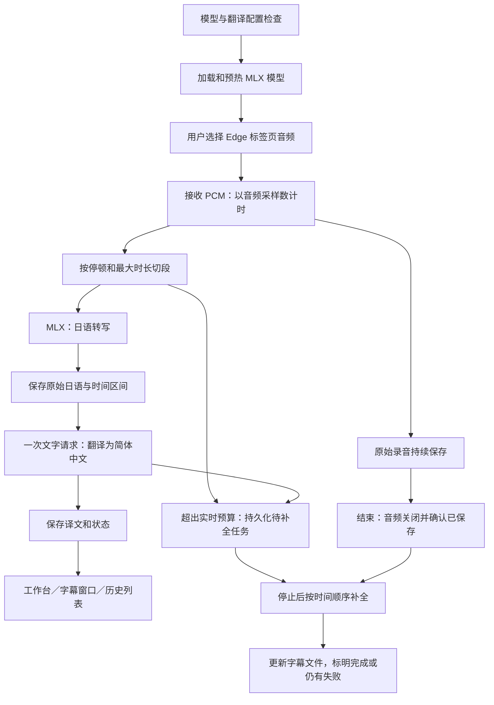

# 直播实时翻译：业务需求与开发交接

更新日期：2026-10-30（北京时间）。适用项目：烤肉台。

## 1. 已确认的产品决策

- 产品有两条业务：直播优先低延迟；上传完整音频优先准确率。
- 本次开发范围是直播。直播 ASR 接入本机 MLX Whisper，使用 Apple Silicon GPU。
- 上传音频仍由 MiniMax 文件 ASR 识别，保留既有文字校对、翻译和字幕导出能力；不得因直播改造覆盖其配置。新增自动质量检查与精确对齐属于后续精修范围。
- 直播只配置一个 ASR 模型和一个文字翻译模型。不要增加独立校对模型这一必填项。
- Small 多语言模型作为首个已准备的候选；Small 与 large-v3-turbo 的最终选择须根据本机实测，不以名称或参数量判定。
- 本文描述待开发行为；安装依赖、下载权重不代表直播代码已经接入 MLX。

## 2. 用户需要完成的事情

1. 启动工作台，看到本机识别模型及翻译服务的就绪状态。
2. 在 Edge 选择正在播放日语直播的标签页，并共享标签页音频。
3. 一边收听，一边看到日语原文和简体中文；字幕保持最新、稳定，不持续落后。
4. 可打开独立字幕窗口，用于全屏或 OBS。
5. 结束时立即知道音频是否保存成功；未完成字幕可在后台补全。
6. 在本机项目中播放录音、查看字幕、重试失败段、下载日语／中文／双语字幕。

首版语言固定日语识别、简体中文翻译。说话人分离、逐字动画、多语种自动检测不属于本次必需范围。

## 3. 核心业务流程

音频存档、识别、翻译是独立职责。识别或翻译异常不能阻止录音落盘。

### 3.1 开始与模型预热

- 启动／准备阶段检查 MLX 环境、GPU 可用性、选定模型的本地权重及翻译配置。
- 模型状态至少区分：未准备、加载中、已就绪、加载失败。不要把“目录存在”视为就绪。
- 录制过程中不临时下载模型。模型来源和精确版本应能查询；使用已下载的绝对路径进行离线推理。
- 默认开始实时字幕前必须模型就绪。若识别失败后仍录音，明确显示“仅录音”。
- 每场固定后端、模型、翻译路由、术语表和切段参数。保存非敏感配置快照，运行中不静默切换。快照仅包含路由引用、模型和参数，禁止复制密钥或完整 settings；凭据继续从本机安全设置解析。

### 3.2 音频采集、切段与识别

- 保留现有浏览器采集和 WAV 保存机制，识别副本转换为 16 kHz 单声道 float32。
- 保留讲话前短预留音频，优先在停顿处断句，连续讲话达到上限必须提交。
- 首轮沿用当前最大 5 秒、静音约 600 ms 作为基线；对比 3 秒／5 秒后再调参。
- 每个已提交区间只识别一次；如采用重叠窗口，必须定义归属与去重，不能重复输出同一句。
- MLX 明确指定 `language="ja"`、`task="transcribe"`。不要用 Whisper 的英语翻译任务代替日译中。
- 使用单个专用推理 worker，预加载并复用一个模型，避免多份模型和并发 GPU 推理。
- 将 MLX 返回字典转换为项目内部事件；不向上层泄漏第三方库的数据格式。
- 静音不生成字幕；确认无语音的区间标记 `no_speech`／`skipped` 终态，不翻译、不反复重试。空响应异常与正常无语音必须区分；音乐、短应答和低置信度结果不得靠扩写补成完整语句。
- MLX Whisper 是分段识别，界面不能宣称已实现逐字流式输出。

### 3.3 一次中文翻译

- 直播关键路径为“识别 → 翻译”，移除当前“独立日语校对 → 中文翻译”两次串行请求。
- 默认输入原始日语、最近少量日语前文、已完成的对应译文以及人名／术语表；不能等待前句翻译才启动当前句。
- 提示词要求忠实、简洁、保留数字和语气、不解释、不扩写、不编造漏听内容。
- 只进行有依据的轻量错字理解，不用文字模型猜回不存在的原音频信息。
- 默认输出中文即可，日文主记录保留 ASR 原稿。如需要校后日语，可在同一次请求中返回，并另存字段。
- 翻译请求有限并发；失败重试受时间预算限制，不能让一个失败句长时间阻塞后续字幕。
- 翻译超时、鉴权失败、限流分别提示；保留日语与音频，错误说明不写入 SRT。

### 3.4 字幕显示

- 确认日文后立即进入历史；译文返回后更新同一个段落。
- 每段有稳定 `segment_id` 和单调递增序号；按音频顺序处理主字幕，不能按请求返回顺序倒退。
- 新日文到来时保留最近一组有效双语字幕。可单独显示“最新识别日文”，但不能把它与上一句中文伪装成同一组双语。
- 迟到的旧译文补入历史与导出文件，不覆盖较新双语主字幕。
- 工作台和独立字幕窗口使用同一份显示状态，避免 OBS 与主页面不一致。
- 事件必须携带场次标识；上一场迟到结果不得更新下一场画面。

### 3.5 排队与补全

原则：实时展示有时限，字幕任务可恢复，已接收到的完整音频持续保存。

- ASR 和翻译内存队列都应有上限，记录队列长度及最老任务的年龄。
- 超出实时预算的旧任务转为 `deferred`，保留区间和状态，不允许无界堆积或无记录丢弃。
- 音频先落盘，再建立引用该区间的任务；不得把尚未持久化的音频标记为可恢复。
- 已识别、未翻译：停止后仅补翻译；未识别：停止后从本机音频区间补识别，再翻译。
- 直播期间优先新字幕；后台补全在停止后使用同一 MLX 模型与直播翻译路由，已成功段不重复付费调用。
- 显示待补全数量。首版不要求引入新消息队列或数据库，可以沿用现有会话文件和原子写入。
- MiniMax 文件精修仍是独立业务，不自动把直播音频上传给 MiniMax。

### 3.6 停止、异常与恢复

状态主线：待机 → 模型准备 → 就绪 → 录制 → 停止采集 → 音频已保存／字幕补全中 → 完成或部分完成。

- 停止时先 flush 浏览器尾包，后端确认已接收，再关闭音频并提交最后一段；尾段不足常规切段时长也要处理。
- 尽快返回“音频已保存”，字幕未完成则单独显示补全进度，不一直用“保存中”掩盖两者区别。
- 正常停止、共享结束、页面离开均尽力保存已经接收的内容；连接断开后未传到服务器的音频不能承诺已保存。
- 重启后恢复中断项目，将未完成 `running` 状态转换为可恢复任务，不能直接标记全部完成。
- `asyncio.to_thread()` 的取消不代表 GPU 推理已停止；推理结束前不能释放模型并启动第二份并发任务。
- 模型崩溃或翻译服务不可用时继续保存录音，提供可理解状态；不得悄悄换云端识别或上传音频。
- 维持当前直播与文件导入互斥策略，本轮不同时扩展多场直播和并行精修。

## 4. 时间轴与存储约束

- 所有字幕时间来自累计采样数，不来自网络返回时间或系统时钟。
- 音频分卷后保持整场连续时间轴；预览、SRT、VTT 和历史列表共享同一时间基准。
- 段落至少保存：场次、ID、序号、起止毫秒、`ja_raw`、日语显示文本、`zh`、ASR 状态、翻译状态、错误摘要和重试次数。
- 阶段状态区分 `pending/running/done/deferred/failed`，另设正常无语音的 `no_speech`／`skipped` 终态；异常空响应、延期、失败不能都当作成功。
- 保存后端、模型路径／版本、翻译模型和本场非敏感配置快照，便于复现结果。session.json 可下载，严禁写入凭据。
- 沿用原始 WAV、日语 SRT、中文 SRT、双语 SRT/VTT、对照文本和 session.json。成功译文才能进入中文轨道。
- 重试沿用原 ID 和时间区间，幂等更新，不能新增重复字幕。
- 新直播按本场快照对应的直播路由补全；所需连接已被删除或失效时提示重新配置，不静默改用另一服务。无快照的旧直播项目首次重试时使用当前明确选择的直播翻译路由并保存其非敏感引用，保留已有校对日语与成功译文，仅补缺失翻译，不重跑 ASR 或独立校对。上传项目重试仍使用文件流程。

## 5. 配置与界面

| 业务 | 需要的配置 | 与另一业务的关系 |
| --- | --- | --- |
| 直播 | 本机后端 MLX、已安装模型、直播翻译连接／模型、术语表、切段设置 | 独立直播路由 |
| 上传精修 | MiniMax 文件 ASR、精修校对和翻译路由 | 保留既有配置及处理能力 |
| 服务商连接 | 地址、密钥、接口协议 | 可以复用连接，不强制共用任务模型和策略 |

- 可使用 `live_asr`、`live_translation` 与现有文件路由实现隔离，具体字段由开发者决定，但必须满足业务隔离。
- 开启直播只验证直播所需配置；不得因文件 ASR 或日语校对未配置而阻止直播。
- 旧字段迁移应保留原值，并明确优先级。不要覆盖用户已有密钥、MiniMax 路由、模型和历史项目。
- 模型选择持久化，页面重载不能自动重置为 Tiny；展示已准备、未准备和准备失败状态。
- 产品主界面显示模型准备、录音、识别、翻译及补全状态；协议细节放入设置或诊断。
- 模型未准备时给出明确操作提示；Tiny 保留为兼容选项，回退需明确说明，不能静默发生。

## 6. MLX 适配中已确认的事项

- 原 `.venv` 使用 Python 3.9.6；新 `.venv-mlx` 使用 ARM64 Python 3.12.14，二者独立。
- 独立依赖入口为 `requirements-mlx.txt`；默认启动脚本目前仍指向原 `.venv`，本次环境准备不等于应用迁移。
- MLX Whisper 使用 `config.json` 与 `weights.safetensors`／`weights.npz`，不能复用 CTranslate2 的 `model.bin`。
- 安装的 `mlx-whisper==0.4.3` 返回字典；`beam_size` 非空会抛出未实现错误，不可照搬当前 `beam_size=1/3`。
- 现有 `vad_filter` 参数不能直接照搬；保留应用现有切段和静音处理。
- 使用本地 float32 数组可避免识别路径依赖系统 ffmpeg；外部音频文件仍由应用已有解码层处理。
- 模型准备与具体检验结果见相邻的 `mlx-local-setup.md`，以真实完成记录为准。

## 7. 现有代码入口

| 文件 | 开发关注点 |
| --- | --- |
| `yakiniku/local_transcriber.py` | 替换／扩展后端、模型就绪检查、格式适配、单 worker 与预加载 |
| `yakiniku/server.py` | LiveSession、创建场次前验证、工厂选择、有限队列、直接翻译、停止与补全、重试 |
| `yakiniku/audio.py` | 音频采样计时、停顿切段、最大段长与尾段 |
| `yakiniku/provider.py` | 复用现有文字服务适配器；直播一次请求及有限重试预算 |
| `yakiniku/text_pipeline.py` | 为直播分离简短路径，保留文件校对→翻译路径 |
| `yakiniku/config.py`、`service_config.py`、`storage.py` | 直播独立配置、兼容迁移、配置快照与可恢复任务 |
| `static/app.js`、`index.html`、`providers.js`、`providers.html` | 模型状态、持久选择、独立直播路由、字幕配对与乱序 |
| `static/audio-worklet.js`、`overlay.js` | 停止尾包、字幕状态同步 |
| `yakiniku/import_audio.py` | 本轮保持 MiniMax 文件精修行为；勿让全局加载器改动破坏旧导入项目 |

## 8. 测量与验收

速度必须拆分记录：切段等待、ASR 排队／推理、翻译排队／请求、字幕显示。用单调时钟测耗时，以采样数定字幕时间。

- 建议首轮目标：切段确认到日文完成 P95 ≤ 1.5 秒；到中文显示 P95 ≤ 3 秒。两者属于待实测工程目标，不是现有性能承诺。
- 上述指标不包含音频段自身时长；同时必须报告“话音结束到中文显示”和连续讲话场景，避免用统计口径隐藏等待。
- 固定同一组日语录音，使用相同切段和翻译配置比较候选模型；记录冷启动、预热后 P50/P95、峰值内存、积压和错漏。
- 真实字幕延迟验收需实际翻译服务；模拟服务测试不能代替网络和质量测试。
- 准确率须人工核对日语样本、人名、数字、游戏术语、短应答和带 BGM 片段；仅“有文本输出”不代表识别正确。

必须覆盖的场景：

1. 连续日语讲话至少 10 分钟，无持续增长的积压；另提供至少 30 分钟稳定性记录。
2. 静音、短停顿、连续讲话、BGM：不漏尾段，不反复输出重复句。
3. 翻译按第 3、1、2 句返回：主字幕不倒退、历史完整且双语配对正确。
4. 人为减慢 ASR／翻译：队列有界、录音正常、延期状态可见、停止后可补全。
5. 翻译超时、429、鉴权失败、网络中断：音频和日语保留，重试有上限。
6. 讲话中停止、停止共享、刷新页面、后端重启：已接收音频可恢复，任务状态真实，无重复字幕。
7. 推理中取消任务／切场：没有并发加载和迟到结果污染。
8. 模型缺失／损坏／GPU 不可用：错误明确，不自动上传音频。
9. 不配置文件 ASR 或独立校对时，直播仍可启动；修改直播配置不改变 MiniMax 文件配置。
10. 原 Tiny 项目可预览／导出／重试；文件导入、字幕导出和现有核心测试无回归。

## 9. 建议开发顺序与交付

1. 使用已准备的环境做离线短音频转写和基准，确认模型接口与 GPU。
2. 接入 MLX 识别层和模型状态，保留原录音与时间轴。
3. 将直播改为一次翻译请求，隔离直播与文件配置及验证。
4. 修复字幕配对、乱序、有限队列、停止与可恢复补全。
5. 更新设置页面与启动方式，完成模拟异常测试和真实直播验证。

开发交付应包括：实现变更、启动说明、必要测试、真实测速记录、人工样本核对、已知限制与回退方式。
不要仅以依赖安装成功、权重下载成功或模拟文本演示作为直播功能完成的依据。

## 10. 可直接发送给开发 agent 的任务

请先阅读本文件和 `docs/mlx-local-setup.md`，在现有烤肉台项目接入 MLX Whisper 作为直播本机 ASR。直播采用“本机日语识别→一次简体中文翻译”，与 MiniMax 文件精修配置隔离。保留录音、采样时间轴、预览和导出能力，处理字幕乱序、尾段、队列积压及中断恢复。优先使用已准备的环境和模型，不重建用户密钥或覆盖已有文件配置；模型的最终默认值由实测决定。完成后提交可复现的启动方法、测试与性能／准确率验证结果，明确区分已实现功能和未达到的目标。
